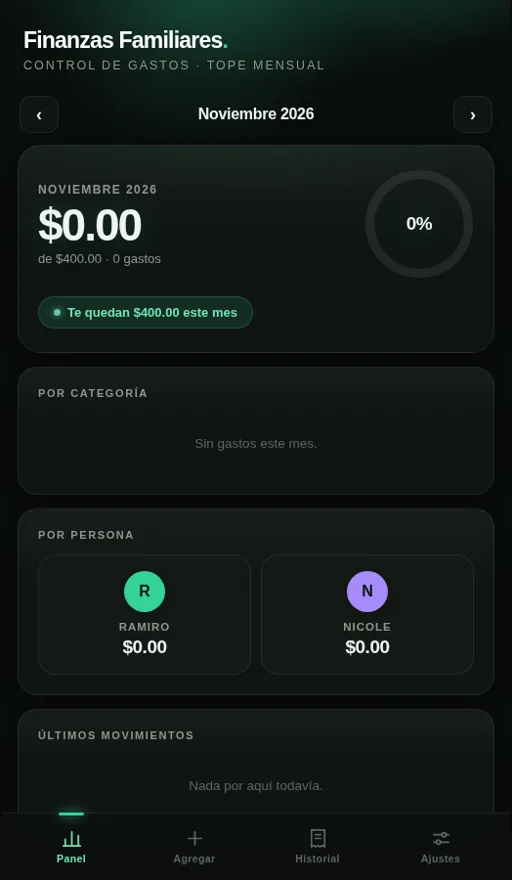

# Finanzas Familiares

A household budgeting PWA built for two people sharing one monthly budget. It tracks spending against a monthly cap, breaks expenses down by category and by person, and syncs in real time between two phones.

**Live app:** https://ramiiron.github.io/finanzas-familiares/



## Features

- Monthly spending cap with a live progress ring and remaining balance
- Expense breakdown **by category** and **by person**
- Add expenses in seconds from the phone; full history by month
- Real-time cloud sync — both phones see the same numbers instantly
- Installable PWA with offline support: expenses are recorded locally and sync when the connection returns
- A companion app, [Ingresos Familiares](https://github.com/ramiiron/ingresos-familiares), tracks photography income separately, on the same design system

## Tech

- Vanilla JavaScript, HTML, and CSS — no framework
- Firebase (cloud sync and storage)
- Service worker for offline use and installability
- Hosted on GitHub Pages

## Run locally

```bash
git clone https://github.com/ramiiron/finanzas-familiares.git
cd finanzas-familiares
python3 -m http.server 8000
# Open http://localhost:8000
```

---

Built and maintained by [Ramiro Bugueño](https://github.com/ramiiron) — IT support specialist & systems administration student.
